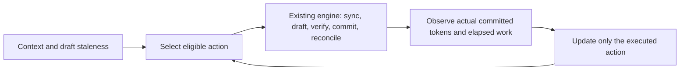

# Experimental cost-aware controller

Design v1, 8 November 2026. **Implemented and measured experimental C++ controller.**
See the [completed engineering result](controller-results.md) for scope, metrics
and the ordinary-decoding comparison.

The user explicitly chose to finish the experimental C++ controller despite the
negative feasibility evidence, then requested a controller-specific design
before implementation. That changes the implementation order; it does not
change the interpretation of earlier experiments. Cap1's completed validation
ratio remains 0.9846 [0.9721, 1.0019], below the practical-gain criterion.
No controller benefit, novelty or full held-out result is assumed.

The requested `$planner` skill is unavailable in this session's skill catalog
and searched filesystem locations. This document supplies the explicit design,
trade-off review, implementation order and test plan instead. Implementation
must follow this contract or record why the design changes.

## 1. Objective and boundary

Choose the next supported action using only information available before that
decision: measured outcomes of previously executed actions, the committed
context length, remaining capacity and draft-cache staleness.

Actions are target-only `0` or draft caps `1,2,4,6,8`. The objective is committed
output tokens per millisecond of complete cycle execution. Accepted drafts are
a diagnostic signal; they are not the objective. The policy never samples a
token, verifies a proposal, changes KV state or invents outcomes for an untried
action. The existing C++ engine and pinned upstream verifier retain those jobs.



This is a single-request experimental scheduler. It is not an optimal policy,
serving system, contextual bandit or predictor with a statistical guarantee.

## 2. State and interfaces

Keep policy logic in `src/policy.*`, independent of llama.cpp and JSON. Use
fixed arrays for the six ordered actions, avoiding allocation in the decision
loop. Runtime integration stays in `src/runtime.*`; JSON parsing and provenance
serialization belong to `src/main.cpp` and the experiment runner.

| State | Meaning |
|---|---|
| Frozen per-action prior | Mean committed tokens and base cycle milliseconds |
| Request estimates | EWMA copies of those priors, updated only from this request |
| Sync estimate | Milliseconds per explicitly synchronized draft token |
| Normal action and age | Incumbent and number of completed normal selections held |
| Probe cursor and cycle count | Deterministic exploration schedule |
| Pending decision | Prevent selecting twice or observing the wrong action |
| Decision trace | Pre-decision estimates, eligibility, score, reason and prediction |

`select_action(context)`, `observe(observation)` and `reset()` remain the policy
contract. Extend observations with actual synchronization time/token count and
the effective draft cap. The engine supplies physical remaining capacity:
the minimum of output budget and remaining context slots.

Every request, including a measured request after warm-up, starts from the same
frozen prior. Reset normal selection, estimates, sync estimate, hold/probe
counters and any pending decision. No learned request state crosses requests.

## 3. Cost model and transition charging

For action `a`, maintain estimates `T[a]` (committed tokens) and `B[a]` (base
cycle milliseconds). For stale draft count `s`, predict:

```text
transition_ms(a, s) = 0                         if a == 0 or s == 0
                    s * sync_ms_per_token      otherwise
predicted_ms(a, s) = B[a] + transition_ms(a, s)
score(a, s)        = T[a] / predicted_ms(a, s)
```

The v1 scoring horizon is one cycle: charge the **full** predicted catch-up
cost to entry/re-entry. Do not silently amortize it over future cycles. This is
conservative and may delay recovery; scheduled probes allow recovery to be
tested. A later amortized horizon requires a declared development experiment.

After a valid completed cycle, use smoothing weight `alpha=0.2`:

```text
T[a] <- (1-alpha)*T[a] + alpha*committed
B[a] <- (1-alpha)*B[a] + alpha*(observed_wall_ms - charged_sync_ms)
```

Subtract actual catch-up only when tokens were synchronized. Zero-token sync
bookkeeping remains in base cost. Update the sync-per-token estimate from an
actual positive-token sync episode. Never add predicted catch-up to an estimate
that already contains that same actual transition: this separation prevents
double charging. All real synchronization remains in measured generation and
cycle wall time regardless of its treatment inside the prediction model.

The linear sync estimate omits batching thresholds and fixed setup effects.
Log predicted and realized transition costs so that error is measurable. Ngram
lookup has no separate draft-model catch-up; its transition estimate is zero.

Online observations include selection and inference work through cache repair.
The current update cannot include its own not-yet-measured bookkeeping time.
Measure update time separately and include it in logged total cycle/generation
time. Quantify this difference; do not claim instrumentation-free execution.

## 4. Selection, stability and probes

1. Build the eligible set. A positive cap must fit while reserving a target
   correction/bonus slot. Exclude caps larger than physical remaining capacity
   minus one; do not score a shortened cap as if it executed the full action.
2. Allow action0 normally, except in the no-fallback ablation. If no positive
   action fits at the last output/context slot, force action0 in every policy
   variant and label it a **budget tail**, not a learned fallback decision.
3. At the first normal decision, choose the highest score. Resolve exact ties
   by the lower action, giving target-only the conservative tie break.
4. Otherwise keep the normal incumbent for at least four completed normal
   cycles. Thereafter switch only if a challenger is at least 5% better.
   Capacity changes may override the hold when the incumbent becomes ineligible.
5. Every 16 completed cycles, probe a different eligible action, rotating through
   alternatives in action order. A probe bypasses hold/margin tests but does not
   become the normal incumbent or advance its normal hold age.
6. Continue probes while target-only is the incumbent. Charge their complete
   execution, subsequent catch-up and any resulting switches to the request.

Update only the action actually requested and executed. If external clamping
still makes its effective cap shorter, mark that observation as tail-limited
and do not use it to learn a full-cap outcome. Fewer proposals caused by EOS,
confidence stopping or an empty ngram match are legitimate outcomes of the full
eligible cap. They remain observations, including zero accepted proposals.

Invalid configuration, impossible counters, a wrong-action observation, missing
pending decision or non-finite/non-positive timing must fail clearly before
changing estimates. In this experimental measurement system, invalid timing is
an invalid trial rather than a silent learning update.

## 5. Frozen calibration and input contract

Require an explicit six-action prior. Do not ship invented performance priors
as trained-model defaults. A configuration records schema version, calibration
ID, all six estimates, sync estimate, alpha, hold/margin/probe settings and the
fallback/probe ablation flags. Validate finite positive costs, feasible expected
token counts, unique complete actions and bounded parameter values.

Calibration uses only designated development fit prompts. Obtain full-action
cycle costs/committed counts from equivalent original-state checkpoint replays;
retain input hashes and source measurements. Measure model catch-up using a
real target-only/re-entry transition. A fixed-length baseline is selected from
complete **request** measurements on development data, not from a hindsight
best checkpoint action. Freeze both selection and prior before validation.

Bind a calibration to executable hash, target/draft hashes, mechanism, cache
mode, CPU/backend settings, context, batch and thread counts. The experiment
runner enforces those bindings before launching generation. The lower-level
C++ API accepts an explicit configuration; callers own its operating-point
compatibility. CLI output must preserve the supplied calibration/provenance.

Synthetic calibration is allowed for fixtures and demos, labeled as such.
Real-model performance analysis rejects synthetic priors masquerading as a
trained operating point. Changing an executable or execution setting requires
a fresh calibration/point rather than bypassing identity checks.

## 6. Runtime and cache behavior

Use existing upstream verification and cache reconciliation without a second
acceptance implementation. Both models stay resident in the model-drafter
experiment. Keep the existing eager initial draft prompt preparation so that
initial prefill boundaries match the fixed baselines; include it in warm latency.
Subsequent target-only advancement makes the draft stale. Re-entering speculation
decodes all missing committed prefix tokens and charges that catch-up online.

The policy reads staleness but never repairs it. The engine asserts cache/count
invariants and supplies actual outcomes only after commit/reconciliation. All
controller variants must preserve ordinary greedy IDs, EOG, budgets and context
stopping. Diagnostic snapshots stay excluded from normal performance requests.

## 7. Observability and ablations

Detailed cycle records should include requested/effective action, reason,
probe/normal-switch/budget-tail flags, six candidate eligibility/scores,
predicted tokens/base/transition time, actual synchronization, complete committed
tokens, selection/update timing and whether learning was applied.

Minimal mode keeps request totals without retaining per-cycle score arrays:
action counts/times/tokens, probes, fallback time/tokens, switches, catch-up and
controller initialization/decision/update cost. Serialize after generation.
Keep controller configuration and calibration identity in request settings.

Required comparisons use the same target and execution path:

- Ordinary target-only and the resident-draft control where applicable.
- Development-frozen global fixed cap, existing dynamic rule and acceptance rule.
- Cost-aware controller, no-target-only ablation and no-probe ablation.
- Minimal versus detailed logging on designated development requests.

Report natural token counts, warm completion time, decode throughput and peak
RSS. Initialization, probes and transitions are measured costs, not free setup
deductions from the adaptive result. Plot action/rate/acceptance trajectories,
prediction error, stage costs, regressions and memory. Select representative
traces by declared median-improvement/worst-regression rules.

## 8. Validation before Codespaces

No further Codespaces execution starts until the controller works in Codex Cloud.
The earlier packed-profile run was cancelled for this sequencing decision;
actual shutdown was confirmed. Treat it as an externally interrupted trial,
not a measured negative result.

Pure C++ policy tests must cover score arithmetic, chosen-action-only updates,
full transition charging, no double counting, four-cycle holds, 5% hysteresis,
probe order/recovery, reset, invalid inputs, clipped samples and mandatory tails.
Integration tests must exercise model and ngram modes, all supported actions,
rejection, EOS, budgets, context limits, fallback/catch-up/re-entry, repeated
requests and minimal/detailed equivalence. Preserve exact token IDs and stops.

CLI/config tests cover missing/duplicate/invalid priors, provenance round trips,
ablations and calibration mismatch rejection. Run Release and address/undefined
sanitizers with leak detection. Keep the default guarded CPU implementation for
the first controller trial; evaluate optional packing as a separate change.

Only after these checks pass: push the checked stage, run a controller-focused
trained gate, calibrate on frozen development data and collect a bounded,
predeclared comparison grid in Codespaces. Full held-out claims require the full
frozen evaluation protocol; a short engineering experiment is labeled accordingly.

## 9. Implementation order and exit checks

1. Pure allocation-free policy/config/trace types and deterministic unit tests.
2. Engine observations, unchanged verification path, request totals and CLI JSON.
3. Differential fixtures, reset/fallback/ablations and sanitizer checks.
4. Calibration/provenance freezing, benchmark configs, analysis and docs.
5. One focused trained test/measurement run, artifact verification and report.

Each stage must be concrete and reviewable before moving on. Keep unfinished
controller behavior visibly experimental. The complete 90-prompt held-out
matrix remains separate from the bounded first trial.

## 10. If measurements disappoint

First distinguish an implementation failure from an uneconomical operating point:
check exactness, timing boundaries, CPU/memory pressure and logging overhead.
Then inspect wasted drafts, target verification cost, synchronization and
prediction error. A cheaper drafter or a verified CPU execution optimization
is justified by a measured bottleneck; a larger model solely to find a win is not.

If policy overhead dominates, simplify its hot path. If probes or catch-up erase
gains, quantify that with the frozen ablations. If predictions drift with context,
evaluate the error on development data before adding model complexity. Re-freeze
after any tuning and preserve unfavorable raw results. Never manufacture a gain
by slowing ordinary decoding, retuning on evaluation data or hiding transitions.

Useful outcomes include a working reusable C++ controller, exactness coverage,
measured overhead and a defensible operating-point/regression analysis. Any
later two-sentence CV description must use those actual results and name its
measured scope; the engineering design and evidence remain the primary deliverable.


## 11. Implementation and use

The implementation follows the design above. `src/policy.*` owns the six-action
state machine; `src/controller_io.*` validates JSON at the executable boundary;
`src/runtime.*` supplies actual elapsed work, committed tokens and cache state.
`bench/controller.py` freezes and binds calibration; `scripts/controller_study.py`
coordinates the bounded trained study; `analysis/controller.py` independently
checks the frozen grid, immutable record hashes, raw outputs, per-request totals
and detailed traces before generating figures/statistics.

Use an explicitly calibrated configuration with the same binary and operating
point. For a single request:

```bash
build-cpu/tokenomics --target /path/to/target.gguf --drafter ngram \
  --policy cost-aware --controller results/controller/prior.json \
  --context 2048 --batch 512 --threads 2 --max-tokens 128 \
  --prompt 'Continue this explanation.' --out request.jsonl --cycles cycles.jsonl
```

For a model drafter add `--draft /path/to/draft.gguf --drafter model` and use its
own measured calibration. Jobs files embed a `controller` object per cost-aware
request. Per-request flags belong in jobs records when using `--jobs`; the CLI
rejects a simultaneous global `--controller`. Missing priors or a controller on
a different policy fail clearly. The raw provenance object survives output.
Direct CLI/API callers own compatibility; `bench.run` enforces the full binding.

A prior JSON contains `schema_version: 1`, `prior_id`, the explicit Boolean
`synthetic`, six unique `priors` entries (`action`, `committed_tokens`, `base_ms`),
and optional validated controller parameters. The generated measured prior also
contains the development fit IDs, executable/model hashes, backend identity,
source hashes and frozen full-request fixed selection in `provenance`. There
is no installed trained-model default. The correctness gate deliberately uses
clearly labeled synthetic priors to force transitions, not to estimate speed.

Export an additional calibration from already captured compatible fit/replay
artifacts without running inference:

```bash
.venv/bin/python -m bench.controller --fit-dir results/controller/fit \
  --replay-dir results/controller/replay --drafter ngram \
  --out results/controller/another-frozen-prior.json
```

This refuses overwriting a frozen file. Fixture sources require the explicit
`--synthetic-fixture` flag; model calibration requires measured catch-up work.

For the repeatable bounded study, after building/checking the controller:

```bash
.venv/bin/python scripts/controller_study.py \
  --model-dir /path/to/model-cache --run-dir results/controller \
  --budget-seconds 6600
```

The fixed protocol is `configs/controller-study-v1.json`: fit on three designated
development prompts at cap64, collect equivalent original-state action replays,
freeze the prior/fixed baseline, then compare seven conditions on six distinct
development validation prompts at caps64/128 with three repetitions. Every
condition uses minimal logging. The conditions are ordinary target, frozen fixed,
existing dynamic ngram cap8, acceptance, cost-aware, no-fallback and no-probes.
A separate paired logging grid runs minimal/detailed controller requests for the
predeclared median-improvement/worst-regression prompts. Its fresh trajectories
illustrate behavior; they are not the exact earlier minimal request histories.

The study first runs focused trained correctness checks with both the 0.5B→1.5B
model drafter and the 3B ngram target, both cache strategies, all three controller
variants, budget tails and repeated/minimal requests. These synthetic-prior gate
timings are excluded from performance analysis. No previous binary's calibration
is reused. The first performance point keeps the guarded CPU profile, selected
because earlier measurements identified independent-draft cost as a bottleneck.
It is an engineering operating point, with no presumed speedup.

The lifecycle supports this same script as phase `controller`; its fixed runner,
ownership, timeout, bounded artifacts and confirmed-shutdown rules still apply.
Codex Cloud tests precede any dispatch. Complete blocks are immutable; canonical
aggregate ordering and preserved completion receipts make an unchanged resume
retain calibration hashes. Any executable/model/source/configuration change
requires a separate run directory. A planned pause retains completed blocks and
has no completed-grid estimate until resumed unchanged.

## 12. Telemetry interpretation and local validation

JSON schema1 is extended additively. Existing fields keep their meanings.
`execution` is present for every policy, including minimal mode: per-action
cycles/tokens/wall time, drafted/accepted counts, verified rows, synchronized
and upstream replay tokens, decision/update and inference-stage clocks.
`controller_active` identifies execution of this policy; `controller` request
totals include probes, incumbent switches, forced tails, ordinary fallback,
learning updates, transition prediction and absolute prediction errors.

`policy_init_ms` is a subset of setup; `controller_parse_ms` is inside warm
request latency. A single-request configuration file read is separately reported
as `controller_file_load_ms` before engine construction. Full process timing in
the benchmark includes loading, warm-up, both requests and serialization.
`observation_ms` stops immediately before the update; `wall_ms` additionally
includes the update and optional trace copy. Generation also includes aggregate
accounting and cycle retention outside that clock. Analysis reports the
unassigned generation remainder instead of silently discarding it. Initialization,
probes and synchronization remain in the complete measured endpoints.

Detailed cycles contain six scored candidates and their eligibility, the selected
and normal action, reason, probe/switch/tail flags, predicted cost/tokens/transition,
observed base cost and post-update estimates. Minimal requests omit those arrays
and retain totals. A forced final-slot action0 is never counted as ordinary fallback.
Tail-limited observations do not update a full-cap action. Ngram may legitimately
propose zero tokens; the selected full-cap observation is still learned.

Local tests cover the deterministic mathematical contract, strict malformed JSON,
real executable/provenance round trips, both mechanisms/cache modes, all actions,
forced rejection, EOS, context/budget boundaries, resets and minimal/detailed
output equivalence. Release and ASan/UBSan with leak detection have passed the
C++ integration; the study pipeline additionally checks calibration mismatch
before model launch, source tampering and byte-stable resume with generated
transformer fixtures. Fixture performance is never evidence of a trained gain.
The current exact test receipt/counts and trained result status are recorded in
the handoff and requirements matrix as each checked stage is committed.


## 13. Current trained run and independent evidence checks

The first controller-focused trained run is 42492089188, exact source
`e98c0fa84a2c2ff52df198f19eae6ce72d51c83c`. It started only after the Cloud
checks above passed. Attempt1 paused after 25/36 blocks; attempt2 completed all
252 validation records and 16 separate logging records. Earlier raw blocks,
fit measurements and prior are byte-identical after resume. Both trained
correctness mechanisms pass 28 records each and exercise all six actions; the
model gate observes 40 synchronized draft tokens. All 1587 final archive members
and raw block/calibration checks pass independent verification. Finalizer job
128815104360 confirms actual Shutdown. The canonical final receipt is separate
from attempt1's partial receipt.

Cost-aware throughput is 0.9709× ordinary decoding [0.9607,0.9810],
0.9943× the frozen fixed1 baseline [0.9853,1.0023], and 1.2048× cap8 ngram
[1.1271,1.2868]. Decision/update cost averages 1.67 microseconds per cycle;
verification dominates. See [results and interpretation](controller-results.md)
for action counts, probes, ablations, prediction error, memory and limitations.

The read-only evidence verifier hashes the outer ZIP, inner archive and every
member, then checks immutable block records, exact output IDs/stops, budgets,
final caches and request/cycle accounting. `scripts/verify_controller_evidence.py`
reconstructs the frozen prior from its retained sources and recomputes the
statistics/intervals. It verifies both correctness gates separately and rejects
changed summaries or altered calibration. It does not start inference or a
Codespace. A separate short publisher may retain only verified artifacts.
The earlier cancelled packed run is explicitly skipped as an interrupted point;
it never receives a successful performance receipt.


The read-only controller demonstration accepts a completed study directory:

```bash
.venv/bin/python scripts/demo_controller.py --run-dir results/controller
```

It verifies calibration and raw logging-grid outputs before printing selected
actions, probes, actual proposals/acceptance, committed tokens, predicted/actual
cycle cost, fallback and mandatory tails. It never starts inference. Omit `--run-dir` to replay the retained, verified
trained trace. Synthetic fixture studies are labeled explicitly.


The complete held-out runner is `scripts/evaluate_controller.py`; its model
measurements remain unexecuted. It rejects an incomplete 90-prompt matrix,
shortened caps/repetitions, synthetic priors and fit/evaluation leakage for a real
run. Supplemental analysis provides memory, fixed-cap fit cost/acceptance,
per-category regressions and ablations without modifying raw measurements.
See [evaluation and analysis](evaluation.md) for exact commands and scope.

Planned pauses retain independently checked complete blocks without producing
unfinished-grid performance estimates. Partial controller receipts use a separate
attempt-specific filename; they cannot become the final canonical result.
The finalizer's actual Shutdown proof is still required for every retained
attempt. Resume the same source before starting a different Codespaces study.


`.github/workflows/policy-contract.yml` automatically runs the pure C++ policy,
commit and strict configuration tests on relevant pushes/PRs, without model
execution or Codespaces. Full inference differential and sanitizer checks remain
separate because that small CI job does not validate backend/model behavior.

## 14. Gated packed-profile extension

The completed guarded result remains immutable. A second operating point may
reuse the C++ policy and the predeclared fit/validation workload, but must not
reuse its learned prior or ordinary baseline. The packed controller entry point
will be separately named and disabled until a SHA-bound canonical packed gate
proves 272 exact comparisons, independent output checks and actual Shutdown.
It must rebuild the exact gate executable, check its binary and target hashes,
run both focused controller gates, then calibrate all actions again on the same
three designated development fit prompts. No parameters or prompt subset will
be tuned from the packed validation outcomes.

The separate protocol retains six validation prompts, caps64/128, three repeats,
all comparators and ablations, and fresh median/worst logging traces. Requests
reset to the new frozen prior. Source/model/executable/configuration bindings,
immutable complete blocks, bounded pauses and independent summary reconstruction
remain required. The artifact checker must distinguish profiles and never turn
a partial packed grid into a canonical complete result. The guarded CLI default
and legacy evidence checks remain supported.

First verify the native gate and paired CPU component study. Launch a new packed
controller measurement only if those results justify it; a prepared command is
not an executed result. This extension changes orchestration/provenance rather
than the C++ scoring, cache ownership or upstream acceptance implementation.

The prepared entry point is explicit:

```bash
.venv/bin/python scripts/controller_study.py \
  --cpu-profile packed --model-dir /path/to/model-cache \
  --run-dir results/local/packed-controller --budget-seconds 6600
# Agent-controlled trained execution, only after the frozen prerequisites pass:
gh workflow run codespace-experiment.yml --ref main \
  -f phase=controller-packed -f candidate=qwen25-05-3-q4 -f drafter=ngram
```

`configs/controller-packed-study-v1.json` is a separate versioned protocol. Its
pending gate digest intentionally prevents execution until the canonical trained
proof is retained and hashed. The local two-profile fixture checks include a new
packed calibration, all three controller variants, both correctness mechanisms,
logging and independent reconstruction. Changed proof, binary, target or CPU
profile is rejected. These fixture timings are never trained performance data.
