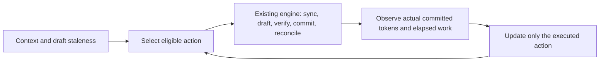

# Experimental cost-aware controller

Design v1, 8 November 2026. **Design stage: implement and validate next.**

The user explicitly chose to finish the experimental C++ controller despite the
negative feasibility evidence, then requested a controller-specific design
before implementation. That changes the implementation order; it does not
change the interpretation of earlier experiments. Cap1's completed validation
ratio remains 0.9846 [0.9721, 1.0019], below the practical-gain criterion.
No controller benefit, novelty or full held-out result is assumed.

The requested `$planner` skill is unavailable in this session's skill catalog
and searched filesystem locations. This document supplies the explicit design,
trade-off review, implementation order and test plan instead. Implementation
must follow this contract or record why the design changes.

## 1. Objective and boundary

Choose the next supported action using only information available before that
decision: measured outcomes of previously executed actions, the committed
context length, remaining capacity and draft-cache staleness.

Actions are target-only `0` or draft caps `1,2,4,6,8`. The objective is committed
output tokens per millisecond of complete cycle execution. Accepted drafts are
a diagnostic signal; they are not the objective. The policy never samples a
token, verifies a proposal, changes KV state or invents outcomes for an untried
action. The existing C++ engine and pinned upstream verifier retain those jobs.



This is a single-request experimental scheduler. It is not an optimal policy,
serving system, contextual bandit or predictor with a statistical guarantee.

## 2. State and interfaces

Keep policy logic in `src/policy.*`, independent of llama.cpp and JSON. Use
fixed arrays for the six ordered actions, avoiding allocation in the decision
loop. Runtime integration stays in `src/runtime.*`; JSON parsing and provenance
serialization belong to `src/main.cpp` and the experiment runner.

| State | Meaning |
|---|---|
| Frozen per-action prior | Mean committed tokens and base cycle milliseconds |
| Request estimates | EWMA copies of those priors, updated only from this request |
| Sync estimate | Milliseconds per explicitly synchronized draft token |
| Normal action and age | Incumbent and number of completed normal selections held |
| Probe cursor and cycle count | Deterministic exploration schedule |
| Pending decision | Prevent selecting twice or observing the wrong action |
| Decision trace | Pre-decision estimates, eligibility, score, reason and prediction |

`select_action(context)`, `observe(observation)` and `reset()` remain the policy
contract. Extend observations with actual synchronization time/token count and
the effective draft cap. The engine supplies physical remaining capacity:
the minimum of output budget and remaining context slots.

Every request, including a measured request after warm-up, starts from the same
frozen prior. Reset normal selection, estimates, sync estimate, hold/probe
counters and any pending decision. No learned request state crosses requests.

## 3. Cost model and transition charging

For action `a`, maintain estimates `T[a]` (committed tokens) and `B[a]` (base
cycle milliseconds). For stale draft count `s`, predict:

```text
transition_ms(a, s) = 0                         if a == 0 or s == 0
                    s * sync_ms_per_token      otherwise
predicted_ms(a, s) = B[a] + transition_ms(a, s)
score(a, s)        = T[a] / predicted_ms(a, s)
```

The v1 scoring horizon is one cycle: charge the **full** predicted catch-up
cost to entry/re-entry. Do not silently amortize it over future cycles. This is
conservative and may delay recovery; scheduled probes allow recovery to be
tested. A later amortized horizon requires a declared development experiment.

After a valid completed cycle, use smoothing weight `alpha=0.2`:

```text
T[a] <- (1-alpha)*T[a] + alpha*committed
B[a] <- (1-alpha)*B[a] + alpha*(observed_wall_ms - charged_sync_ms)
```

Subtract actual catch-up only when tokens were synchronized. Zero-token sync
bookkeeping remains in base cost. Update the sync-per-token estimate from an
actual positive-token sync episode. Never add predicted catch-up to an estimate
that already contains that same actual transition: this separation prevents
double charging. All real synchronization remains in measured generation and
cycle wall time regardless of its treatment inside the prediction model.

The linear sync estimate omits batching thresholds and fixed setup effects.
Log predicted and realized transition costs so that error is measurable. Ngram
lookup has no separate draft-model catch-up; its transition estimate is zero.

Online observations include selection and inference work through cache repair.
The current update cannot include its own not-yet-measured bookkeeping time.
Measure update time separately and include it in logged total cycle/generation
time. Quantify this difference; do not claim instrumentation-free execution.

## 4. Selection, stability and probes

1. Build the eligible set. A positive cap must fit while reserving a target
   correction/bonus slot. Exclude caps larger than physical remaining capacity
   minus one; do not score a shortened cap as if it executed the full action.
2. Allow action0 normally, except in the no-fallback ablation. If no positive
   action fits at the last output/context slot, force action0 in every policy
   variant and label it a **budget tail**, not a learned fallback decision.
3. At the first normal decision, choose the highest score. Resolve exact ties
   by the lower action, giving target-only the conservative tie break.
4. Otherwise keep the normal incumbent for at least four completed normal
   cycles. Thereafter switch only if a challenger is at least 5% better.
   Capacity changes may override the hold when the incumbent becomes ineligible.
5. Every 16 completed cycles, probe a different eligible action, rotating through
   alternatives in action order. A probe bypasses hold/margin tests but does not
   become the normal incumbent or advance its normal hold age.
6. Continue probes while target-only is the incumbent. Charge their complete
   execution, subsequent catch-up and any resulting switches to the request.

Update only the action actually requested and executed. If external clamping
still makes its effective cap shorter, mark that observation as tail-limited
and do not use it to learn a full-cap outcome. Fewer proposals caused by EOS,
confidence stopping or an empty ngram match are legitimate outcomes of the full
eligible cap. They remain observations, including zero accepted proposals.

Invalid configuration, impossible counters, a wrong-action observation, missing
pending decision or non-finite/non-positive timing must fail clearly before
changing estimates. In this experimental measurement system, invalid timing is
an invalid trial rather than a silent learning update.

## 5. Frozen calibration and input contract

Require an explicit six-action prior. Do not ship invented performance priors
as trained-model defaults. A configuration records schema version, calibration
ID, all six estimates, sync estimate, alpha, hold/margin/probe settings and the
fallback/probe ablation flags. Validate finite positive costs, feasible expected
token counts, unique complete actions and bounded parameter values.

Calibration uses only designated development fit prompts. Obtain full-action
cycle costs/committed counts from equivalent original-state checkpoint replays;
retain input hashes and source measurements. Measure model catch-up using a
real target-only/re-entry transition. A fixed-length baseline is selected from
complete **request** measurements on development data, not from a hindsight
best checkpoint action. Freeze both selection and prior before validation.

Bind a calibration to executable hash, target/draft hashes, mechanism, cache
mode, CPU/backend settings, context, batch and thread counts. The experiment
runner enforces those bindings before launching generation. The lower-level
C++ API accepts an explicit configuration; callers own its operating-point
compatibility. CLI output must preserve the supplied calibration/provenance.

Synthetic calibration is allowed for fixtures and demos, labeled as such.
Real-model performance analysis rejects synthetic priors masquerading as a
trained operating point. Changing an executable or execution setting requires
a fresh calibration/point rather than bypassing identity checks.

## 6. Runtime and cache behavior

Use existing upstream verification and cache reconciliation without a second
acceptance implementation. Both models stay resident in the model-drafter
experiment. Keep the existing eager initial draft prompt preparation so that
initial prefill boundaries match the fixed baselines; include it in warm latency.
Subsequent target-only advancement makes the draft stale. Re-entering speculation
decodes all missing committed prefix tokens and charges that catch-up online.

The policy reads staleness but never repairs it. The engine asserts cache/count
invariants and supplies actual outcomes only after commit/reconciliation. All
controller variants must preserve ordinary greedy IDs, EOG, budgets and context
stopping. Diagnostic snapshots stay excluded from normal performance requests.

## 7. Observability and ablations

Detailed cycle records should include requested/effective action, reason,
probe/normal-switch/budget-tail flags, six candidate eligibility/scores,
predicted tokens/base/transition time, actual synchronization, complete committed
tokens, selection/update timing and whether learning was applied.

Minimal mode keeps request totals without retaining per-cycle score arrays:
action counts/times/tokens, probes, fallback time/tokens, switches, catch-up and
controller initialization/decision/update cost. Serialize after generation.
Keep controller configuration and calibration identity in request settings.

Required comparisons use the same target and execution path:

- Ordinary target-only and the resident-draft control where applicable.
- Development-frozen global fixed cap, existing dynamic rule and acceptance rule.
- Cost-aware controller, no-target-only ablation and no-probe ablation.
- Minimal versus detailed logging on designated development requests.

Report natural token counts, warm completion time, decode throughput and peak
RSS. Initialization, probes and transitions are measured costs, not free setup
deductions from the adaptive result. Plot action/rate/acceptance trajectories,
prediction error, stage costs, regressions and memory. Select representative
traces by declared median-improvement/worst-regression rules.

## 8. Validation before Codespaces

No further Codespaces execution starts until the controller works in Codex Cloud.
The earlier packed-profile run was cancelled for this sequencing decision;
actual shutdown was confirmed. Treat it as an externally interrupted trial,
not a measured negative result.

Pure C++ policy tests must cover score arithmetic, chosen-action-only updates,
full transition charging, no double counting, four-cycle holds, 5% hysteresis,
probe order/recovery, reset, invalid inputs, clipped samples and mandatory tails.
Integration tests must exercise model and ngram modes, all supported actions,
rejection, EOS, budgets, context limits, fallback/catch-up/re-entry, repeated
requests and minimal/detailed equivalence. Preserve exact token IDs and stops.

CLI/config tests cover missing/duplicate/invalid priors, provenance round trips,
ablations and calibration mismatch rejection. Run Release and address/undefined
sanitizers with leak detection. Keep the default guarded CPU implementation for
the first controller trial; evaluate optional packing as a separate change.

Only after these checks pass: push the checked stage, run a controller-focused
trained gate, calibrate on frozen development data and collect a bounded,
predeclared comparison grid in Codespaces. Full held-out claims require the full
frozen evaluation protocol; a short engineering experiment is labeled accordingly.

## 9. Implementation order and exit checks

1. Pure allocation-free policy/config/trace types and deterministic unit tests.
2. Engine observations, unchanged verification path, request totals and CLI JSON.
3. Differential fixtures, reset/fallback/ablations and sanitizer checks.
4. Calibration/provenance freezing, benchmark configs, analysis and docs.
5. One focused trained test/measurement run, artifact verification and report.

Each stage must be concrete and reviewable before moving on. Keep unfinished
controller behavior visibly experimental. The complete 90-prompt held-out
matrix remains separate from the bounded first trial.

## 10. If measurements disappoint

First distinguish an implementation failure from an uneconomical operating point:
check exactness, timing boundaries, CPU/memory pressure and logging overhead.
Then inspect wasted drafts, target verification cost, synchronization and
prediction error. A cheaper drafter or a verified CPU execution optimization
is justified by a measured bottleneck; a larger model solely to find a win is not.

If policy overhead dominates, simplify its hot path. If probes or catch-up erase
gains, quantify that with the frozen ablations. If predictions drift with context,
evaluate the error on development data before adding model complexity. Re-freeze
after any tuning and preserve unfavorable raw results. Never manufacture a gain
by slowing ordinary decoding, retuning on evaluation data or hiding transitions.

Useful outcomes include a working reusable C++ controller, exactness coverage,
measured overhead and a defensible operating-point/regression analysis. Any
later two-sentence CV description must use those actual results and name its
measured scope; the engineering design and evidence remain the primary deliverable.
